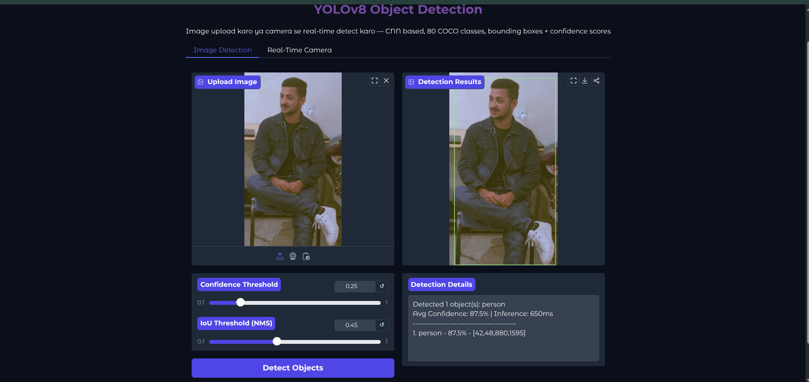

# YOLOv8 Object Detection — CNN Based Complete Project

Real-time CNN-based object detection using **YOLOv8** with interactive Gradio UI, deployed on Hugging Face Spaces.

## Live Demo

🔗 **[Try it on Hugging Face Spaces](https://huggingface.co/spaces/zahidmiana/yolo-object-detection)**



## Features

- **Image Detection** — Upload any image and detect 80 COCO class objects with bounding boxes + confidence scores
- **Real-Time Camera** — Live webcam streaming detection with frame-by-frame YOLO inference
- **Adjustable Thresholds** — Confidence and IoU (NMS) sliders for fine control
- **Video Detection** — Frame-by-frame YOLO on video files
- **Evaluation Metrics** — IoU calculation, Precision, Recall, mAP, IoU heatmap
- **Batch Inference** — Run detection on multiple images at once
- **Gradio UI** — Modern interactive interface with detection table + JSON output

## YOLO Architecture

| Component | Detail |
|-----------|--------|
| **Backbone** | CSPDarknet53 — multi-scale feature extraction |
| **Neck** | PANet — feature fusion across scales |
| **Head** | Decoupled head — separate bbox regression + classification |
| **Anchor-Free** | No predefined anchors, simpler training |
| **Single Pass** | Entire image processed in one forward pass — real-time speed |

## Model Details

| Model | Params | mAP@50 | Speed (ms) |
|-------|--------|--------|------------|
| YOLOv8n | 3.2M | 37.3 | 1.2 |
| **YOLOv8s (used)** | **11.2M** | **44.9** | **2.1** |
| YOLOv8m | 25.9M | 50.2 | 5.0 |
| YOLOv8l | 43.7M | 52.9 | 8.1 |
| YOLOv8x | 68.2M | 53.9 | 12.1 |

## Project Structure

```
YOLO_ObjectDetection/
├── YOLO_Object_Detection.ipynb   # Complete notebook (12 sections)
├── yolointerface.png             # App screenshot
├── sample_images/                # Test images
│   ├── street.jpg
│   └── zidane.jpg
├── huggingface_deploy/           # HF Spaces deployment files
│   ├── app.py                    # Gradio app (image + webcam)
│   ├── requirements.txt
│   └── README.md                 # HF Space config
└── README.md                     # This file
```

## Notebook Sections

1. **Install & Import** — All dependencies + library setup
2. **Model Loading** — YOLOv8s pretrained on COCO (80 classes)
3. **Image Preprocessing** — Download sample images, display original
4. **Inference** — Run YOLO detection with conf/iou thresholds
5. **Extract Detections** — Bounding boxes, scores, class labels → DataFrame
6. **Visualization** — Custom `draw_detections()` function + built-in plot
7. **Charts** — Confidence bar chart + class distribution pie chart
8. **Batch Inference** — Multiple images detection at once
9. **Video Detection** — Frame-by-frame detection with timeline chart
10. **Evaluation Metrics** — IoU, Precision, Recall, IoU heatmap, quality chart
11. **Gradio UI** — Interactive detection with HTML table + filters
12. **Advanced UI** — Tabbed interface with sliders, class filter, JSON output

## Tech Stack

- **Python** 3.13
- **PyTorch** — Deep learning framework
- **Ultralytics YOLOv8** — Object detection model
- **OpenCV** — Image processing + drawing
- **Gradio** — Interactive web UI
- **Matplotlib** — Visualization + charts
- **Pandas** — Data analysis
- **NumPy** — Numerical computing

## Quick Start

```bash
# Clone the repo
git clone https://github.com/ZahidMiana/YOLO_Object_Detection.git
cd YOLO_Object_Detection

# Install dependencies
pip install ultralytics gradio opencv-python-headless numpy Pillow matplotlib pandas torch

# Run the notebook
jupyter notebook YOLO_Object_Detection.ipynb

# Or run the Gradio app directly
cd huggingface_deploy
python app.py
```

## Deployment

The app is deployed on **Hugging Face Spaces**:
- Space: [zahidmiana/yolo-object-detection](https://huggingface.co/spaces/zahidmiana/yolo-object-detection)
- SDK: Gradio
- Features: Image upload + live webcam detection

## License

MIT
